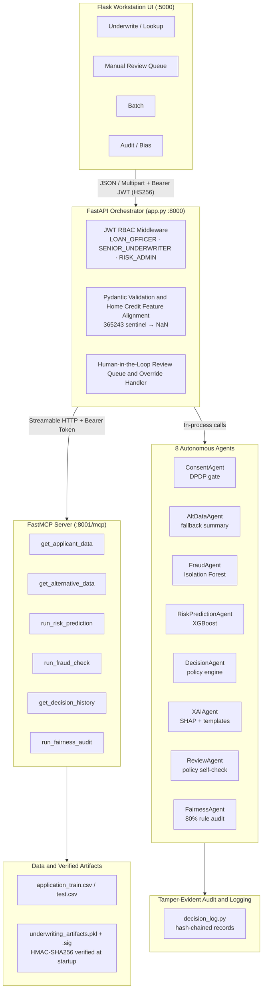

#  Agentic Underwriting Workstation (Home Credit Edition)

> A multi-agent credit risk assessment and underwriting operations workstation built on the Kaggle Home Credit Default Risk dataset, featuring explainable AI (SHAP), anomaly detection, HS256 JWT Role-Based Access Control (RBAC), HMAC-signed model artifacts, hash-chained audit logging, and Model Context Protocol (MCP) tool integration.

<p align="center">
  
  
  
  
  
  
  
</p>

---

## 📌 Problem Statement

Traditional underwriting relies on rigid manual rules or opaque black-box models that lack transparent explanations, human-in-the-loop escalation workflows, and cryptographic auditability.

This project implements a local-first **Enterprise Agentic Underwriting Workstation** combining Kaggle Home Credit borrower profiles with modular risk, fraud, explainability, and governance agents to provide:

- **Dynamic Credit-Risk Scoring (0–100):** Derived from calibrated XGBoost default probabilities (`(1 - PD) × 100`).
- **Explainable Decisions:** Exact SHAP feature attributions paired with outcome-aligned, plain-language compliance letters (zero external LLM required).
- **Fraud & Anomaly Screening:** Unsupervised Isolation Forest combined with deterministic heuristic rules.
- **Role-Based Workstation Operations:** 4-tab console supporting single-applicant MCP lookup, Senior Underwriter manual review overrides, vectorized batch CSV scoring, fairness auditing, and controlled retraining.
- **Cryptographic Governance:** HMAC-SHA256 signed model artifacts, hash-chained decision logs, and DPDP Act 2023 consent gating.

---

## ✨ Key Features (v2.0)

### 1. Multi-Agent Underwriting Pipeline
- **ConsentAgent:** Enforces explicit applicant consent (`HTTP 403` hard stop when `consent_given` is `False`) aligned with India's DPDP Act 2023.
- **Authoritative MCP Data Enrichment:** Queries `mcp_server.py` (`127.0.0.1:8001/mcp`) over authenticated Streamable HTTP (`Bearer` token) to fetch real `SK_ID_CURR` records from `application_test.csv` and merge them into the inference row beneath explicit UI overrides.
- **FraudAgent:** Runs an Isolation Forest (`contamination=0.05`) alongside domain anomaly checks (`LOW`, `ELEVATED`, `CRITICAL`).
- **RiskPredictionAgent:** Predicts default probability (`PD`) via XGBoost and maps scores into four risk tiers (`TIER_1_EXCELLENT` 75+, `TIER_2_GOOD` 60–74.9, `TIER_3_MODERATE` 45–59.9, `TIER_4_HIGH_RISK` < 45).
- **DecisionAgent:** Applies deterministic policy precedence: `Consent Gate → Fraud/Anomaly Override → Score Thresholds`.
- **XAIAgent:** Computes SHAP attributions on preprocessed features and drafts outcome-aligned regulatory decision letters using deterministic compliance templates (with an optional local Ollama hook if configured).
- **ReviewAgent:** Rules-based policy fail-safe that checks score-band consistency, fraud conflicts, protected-attribute leakage in SHAP drivers, and letter accuracy—routing any failed check to `FLAGGED_FOR_MANUAL_REVIEW`.
- **FairnessAgent:** Audits approval parity across demographic groups using the 80% disparate-impact rule (`RISK_ADMIN` restricted).

### 2. Role-Based Access Control (HS256 JWT RBAC)
| Role | Demo Credentials | Permitted Operations |
| :--- | :--- | :--- |
| **`LOAN_OFFICER`** | `officer` / `officer123` | Single-applicant underwriting, MCP `SK_ID_CURR` lookup, batch CSV scoring, view review queue & audit history. |
| **`SENIOR_UNDERWRITER`** | `underwriter` / `underwriter123` | All Loan Officer actions **plus** approving or declining escalated applications in the **Manual Review Queue** with signed audit notes. |
| **`RISK_ADMIN`** | `admin` / `admin123` | All actions **plus** running **Fairness Audits** and triggering hot-reloaded **Model Retraining**. |

### 3. Operational Workstation Workflows (4-Tab Console)
1. **Tab 1 — Underwrite / Lookup:** Load Home Credit presets (`100001`, `100005`, `100013`, `HIGH_RISK_CUSTOM`) or fetch any `SK_ID_CURR` live via MCP to inspect the risk gauge, fraud signal, policy self-check, SHAP driver bars, and decision letter.
2. **Tab 2 — Manual Review Queue:** Live counter of `FLAGGED_FOR_MANUAL_REVIEW` and `CONDITIONAL_APPROVAL` applications where Senior Underwriters issue final overrides with audit notes.
3. **Tab 3 — Batch Scoring:** Upload a Home Credit CSV (up to 500 rows / 10 MB) for vectorized XGBoost + Isolation Forest portfolio scoring.
4. **Tab 4 — Audit & Fairness:** Run 80% rule fairness audits, trigger model retraining with HMAC re-signing, and inspect the immutable decision and override audit trail.

---
## 🏗️ System Architecture



### Layer Summary

| Layer | Component | Responsibility |
|-------|-----------|----------------|
| Presentation | Flask Workstation UI (`:5000`) | Four-tab interface: underwriting, review queue, batch, audit/bias |
| Orchestration | FastAPI (`app.py`, `:8000`) | JWT RBAC, input validation, review queue, overrides |
| Tooling | FastMCP (`:8001/mcp`) | Authenticated tool access to applicant data, risk, fraud, history and fairness |
| Intelligence | 8 agents | Consent, alternative data, fraud, risk, decision, explainability, review, fairness |
| Data | CSVs + signed model artifacts | Home Credit datasets; HMAC-SHA256 verified on startup |
| Compliance | `decision_log.py` | Hash-chained, tamper-evident decision log |

## 🏗️ System Architecture

```text
+-----------------------------------------------------------------------------------+
|                        4-TAB FLASK WORKSTATION UI (:5000)                         |
|  [1. Underwrite / Lookup]  [2. Manual Review Queue]  [3. Batch]  [4. Audit/Bias]  |
+-----------------------------------------+-----------------------------------------+
                                          | JSON / Multipart + Bearer JWT (HS256)
                                          v
+-----------------------------------------------------------------------------------+
|                        FASTAPI ORCHESTRATOR (app.py :8000)                        |
|  • JWT RBAC Middleware (LOAN_OFFICER | SENIOR_UNDERWRITER | RISK_ADMIN)           |
|  • Pydantic Validation & Home Credit Feature Alignment (365243 Sentinel -> NaN)   |
|  • Human-in-the-Loop Manual Review Queue & Override Handler                       |
+-------------------+-------------------------------------------+-------------------+
                    | Streamable HTTP + Bearer Token            | In-Process Calls
                    v                                           v
+---------------------------------------+   +---------------------------------------+
|      FASTMCP SERVER (:8001/mcp)       |   |       8 AUTONOMOUS AGENTS LAYER       |
|  • get_applicant_data(SK_ID_CURR)     |   |  1. ConsentAgent (DPDP Gate)          |
|  • get_alternative_data               |   |  2. AltDataAgent (Fallback Summary)   |
|  • run_risk_prediction                |   |  3. FraudAgent (Isolation Forest)     |
|  • run_fraud_check                    |   |  4. RiskPredictionAgent (XGBoost)     |
|  • get_decision_history               |   |  5. DecisionAgent (Policy Engine)     |
|  • run_fairness_audit                 |   |  6. XAIAgent (SHAP + Templates)       |
+-------------------+-------------------+   |  7. ReviewAgent (Policy Self-Check)   |
                    |                       |  8. FairnessAgent (80% Rule Audit)    |
                    v                       +-------------------+-------------------+
+---------------------------------------+                       |
|      DATA & VERIFIED ARTIFACTS        |                       v
|  • application_train.csv / test.csv   |   +---------------------------------------+
|  • underwriting_artifacts.pkl (.sig)  |   |   TAMPER-EVIDENT AUDIT & LOGGING      |
|    (HMAC-SHA256 Verified at Startup)  |   |  • decision_log.py (Hash-Chained)     |
+---------------------------------------+   +---------------------------------------+

```

---

## Decision Policy Precedence

| Order | Condition | Outcome |
| --- | --- | --- |
| 1 | `consent_given == False` | `REJECTED_NON_COMPLIANT` (HTTP 403) |
| 2 | `is_anomalous == True` or `CRITICAL` fraud | `FLAGGED_FOR_MANUAL_REVIEW` |
| 3 | `ReviewAgent` self-check failure | `FLAGGED_FOR_MANUAL_REVIEW` |
| 4 | `credit_risk_score >= 60.0` | `APPROVED` |
| 5 | `45.0 <= credit_risk_score < 60.0` | `CONDITIONAL_APPROVAL` (queued for review) |
| 6 | `credit_risk_score < 45.0` | `DECLINED` |

---

## 📂 Project Structure

```text
underwriting_engine/
│
├── agents/
│   ├── __init__.py
│   ├── alt_data_agent.py
│   ├── consent_agent.py
│   ├── decision_agent.py
│   ├── fairness_agent.py
│   ├── fraud_agent.py
│   ├── review_agent.py
│   ├── risk_prediction_agent.py
│   └── xai_agent.py
│
├── app.py                        # FastAPI orchestrator & RBAC endpoints (port 8000)
├── mcp_server.py                 # Authenticated FastMCP tool server (port 8001)
├── dashboard_flask.py            # 4-tab RBAC workstation console (port 5000)
├── train_model.py                # Home Credit training & HMAC-SHA256 signing
├── security.py                   # HMAC verification, safe_text, constant-time checks
├── decision_log.py               # Hash-chained audit log helpers
├── config.py                     # Paths, ports & environment secret loader
│
├── application_train.csv         # Kaggle Home Credit training data
├── application_test.csv          # Kaggle Home Credit test data (MCP lookup & audit)
├── underwriting_artifacts.pkl    # Signed XGBoost, Isolation Forest & SHAP artifacts
├── underwriting_artifacts.pkl.sig
├── decision_log.csv
└── README.md

```

---

## 🚀 Getting Started

### 1. Install Dependencies

```bash
pip install fastapi uvicorn pandas numpy scikit-learn xgboost shap joblib pydantic requests httpx mcp flask scipy

```

### 2. Configure Secrets (`.env` or Environment Variables)

Set `UW_MCP_TOKEN` and `UW_ARTIFACT_KEY` in your `.env` file (never commit secrets to version control).

### 3. Train & Sign Model Artifacts

```bash
python train_model.py

```

### 4. Start the Three Services

Run each command from `underwriting_engine/` in a separate terminal:

```bash
# Terminal 1 — FastMCP Tool Server (Port 8001)
python mcp_server.py

# Terminal 2 — FastAPI Underwriting & RBAC Backend (Port 8000)
python app.py

# Terminal 3 — 4-Tab Flask Workstation UI (Port 5000)
python dashboard_flask.py

```

* **Workstation UI:** `http://127.0.0.1:5000`
* **Swagger / OpenAPI Docs:** `http://127.0.0.1:8000/docs`
* **MCP Endpoint:** `http://127.0.0.1:8001/mcp` (requires `Authorization: Bearer <UW_MCP_TOKEN>`)

---

## 🔌 REST API Reference (`127.0.0.1:8000`)

| Method | Endpoint | Required Permission | Purpose |
| --- | --- | --- | --- |
| `POST` | `/api/v1/auth/login` | Public | Authenticate user and issue HS256 JWT + permissions |
| `GET` | `/api/v1/auth/me` | `view_history` | Inspect active JWT claims and role permissions |
| `GET` | `/api/v1/mcp-status` | `lookup` | Verify MCP Streamable HTTP connectivity and tools |
| `GET` | `/api/v1/mcp-applicant/{id}` | `lookup` | Fetch Home Credit borrower row by `SK_ID_CURR` |
| `POST` | `/api/v1/underwrite` | `underwrite` | Run full 8-agent underwriting, SHAP, self-check & audit log |
| `GET` | `/api/v1/review-queue` | `view_history` | List applications awaiting Senior Underwriter review |
| `POST` | `/api/v1/review-queue/{id}/override` | `override_review` | Approve/decline flagged case with signed audit note |
| `POST` | `/api/v1/underwrite/batch` | `batch` | Vectorized batch CSV scoring (up to 500 rows / 10 MB) |
| `GET` | `/api/v1/audit-history` | `view_history` | View chronological decision and override audit log |
| `GET` | `/api/v1/decision-history/{id}` | `view_history` | Query hash-chained decision history for one applicant |
| `GET` | `/api/v1/fairness-audit` | `fairness_audit` | Run 80% rule disparate-impact audit (`RISK_ADMIN`) |
| `POST` | `/api/v1/admin/retrain` | `retrain` | Retrain, re-sign, and hot-reload model artifacts (`RISK_ADMIN`) |

---

## 🔒 Security & Responsible Use

* **Artifact Integrity:** Model pickles are verified against an HMAC-SHA256 signature (`security.py`) before `joblib.load()` executes.
* **Tamper-Evident Logging:** `decision_log.py` chains each decision record to the preceding entry's cryptographic hash.
* **Protected Attribute Governance:** Sensitive demographic attributes (`NAME_FAMILY_STATUS`, `ORGANIZATION_TYPE`, `OCCUPATION_TYPE`, `CODE_GENDER`) are excluded from training features and monitored by `ReviewAgent`.
* **Disclaimer:** Built as a software engineering and responsible-AI learning project. Not validated or licensed for live commercial lending.

```

```
